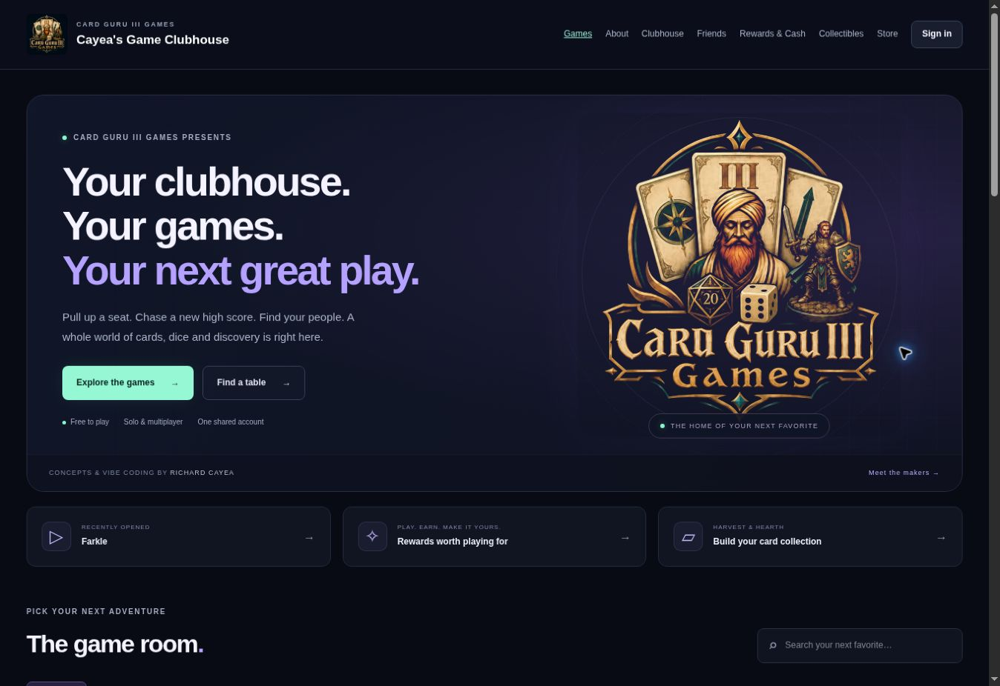

# Clubhouse 2.0 web refresh

Based on `clubhouse2.0`, preserving its complete game application, authoritative APIs, member authentication, wallets, multiplayer, friends and collections.

## Included

- Dark gaming interface with violet and mint accents, responsive game cards and clearer navigation.
- All 13 game entries, searchable by title or description and filterable by category.
- Device-local favorites and recently opened game shortcuts. These are explicitly distinguished from account-synced game progress and rewards.
- Colored Card Guru III Games logo in the HTML startup splash, route loading component, navigation and home feature.
- Cayea Digital publisher branding in the footer and credits; supplied monochrome Card Guru logo retained as an asset.
- Creator credits for Richard Cayea's concepts, creative direction and vibe coding, and OpenAI AI-assisted coding and artwork.
- Updated web-app manifest and app icons; Add to home screen control uses a browser installation prompt when available and platform-specific instructions otherwise. Online features require connectivity.
- Original source game artwork is retained; five delivery-only AVIF atlases are recompressed to fit the existing embedded-asset Worker hosting limit.

## Validation

- `npm run typecheck` passes.
- `npm test`: 85 files, 1,425 tests passed.
- Browser checks: Cards filter returns four games, Hearts favorite toggle and Favorites filter work, Farkle search returns one game, Farkle starts against a computer, recently opened shortcut points back to Farkle, and both studio logos and creator credits appear.
- Desktop browser visual inspection completed. Responsive CSS is implemented; a physical Android-device pass remains outstanding.

## Remaining launch setup

The website remains free to play and retains its existing earned-currency store. Real-money cosmetic checkout and external commercial ads are not enabled in this change. A payment provider account, an approved cosmetic product/price catalog, purchase verification/fulfillment and an advertising account are needed before implementing and activating them. No simulated purchases or ad revenue are presented as live.

No downloadable game packages were supplied, so the site does not fabricate download buttons. Its existing games remain playable on the web.

Sites read access found the current project, but source-write access returned `Sites project not found`; Sites search reported `Select a workspace before searching Sites`. The existing project ID and database binding remain unchanged. Publication must resume in the correct Sites workspace rather than creating a replacement or changing the live database.
